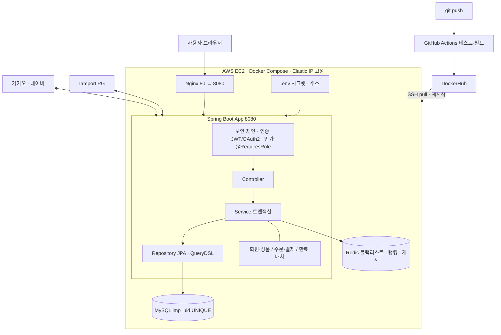
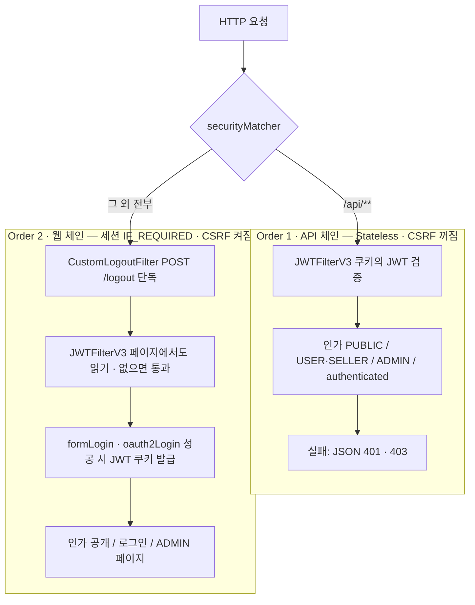
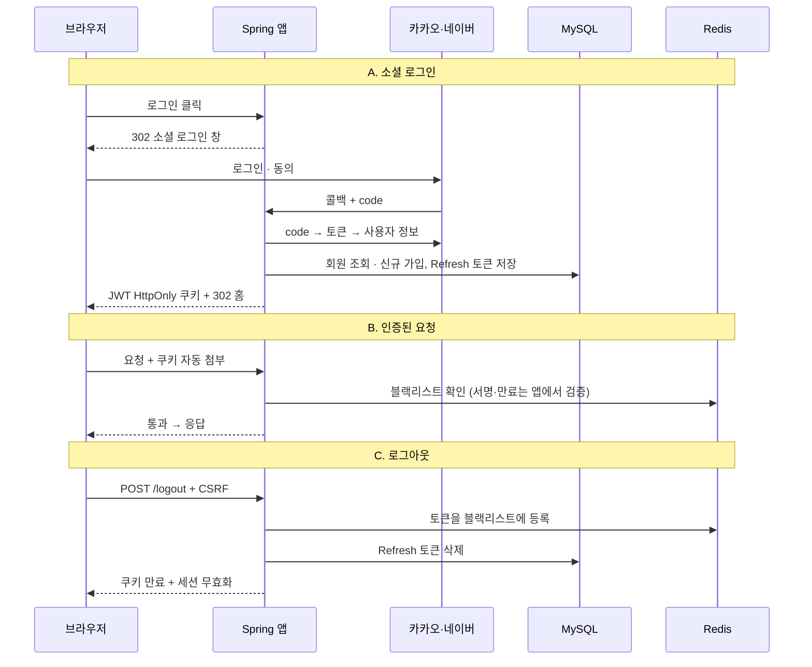
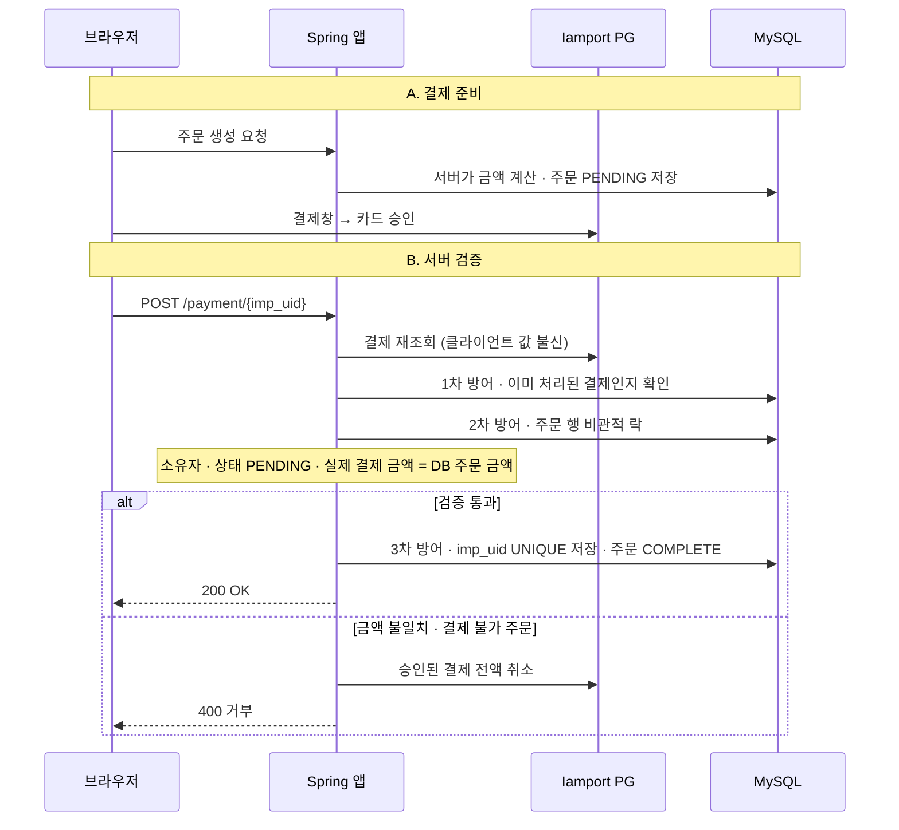
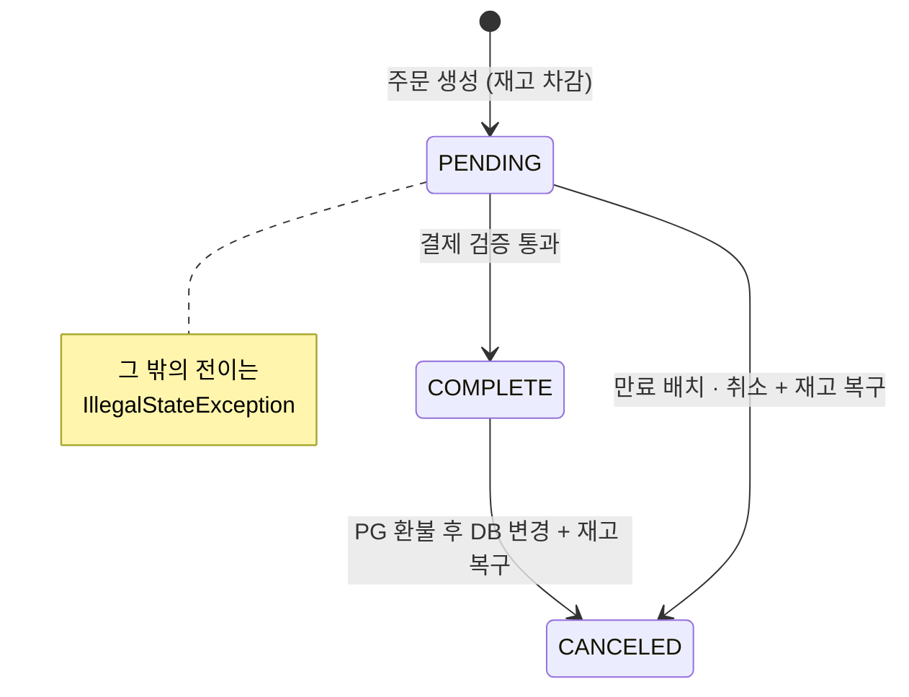
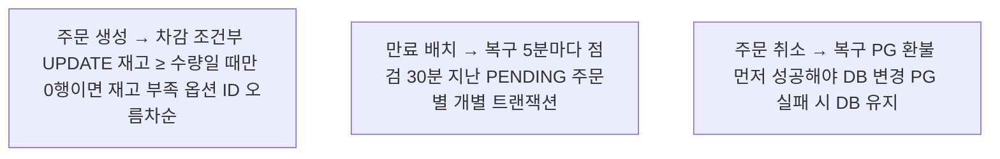
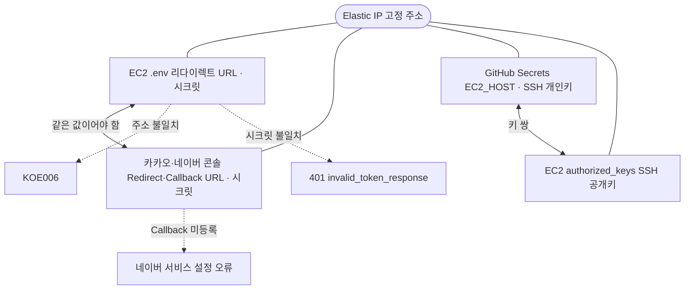

# JooShop 구조 설계 — 면접 설명 노트

> 목적: 면접에서 "구조를 어떻게 설계했나요?"를 막힘없이 설명하기 위한 정리.
> 이 문서의 모든 내용은 실제 코드 기준으로 확인했다 (클래스·메서드 이름은 그대로 말해도 된다).
> 읽는 순서: **1(말하기 스크립트)** → **2(한눈에 보는 구조)** → **3(설계 원칙)** → **4(영역별 설계)** → **5(예상 질문)** → **6(한계)**.

---

## 1. 말하기 스크립트

### 30초 버전

> JooShop은 Spring Boot 3 기반 쇼핑몰 백엔드입니다. 구조를 짤 때 가장 신경 쓴 건 **"무엇이 기준이고, 어디까지 누가 책임지는가"를 먼저 정하는 것**이었습니다. 주문 금액의 기준은 화면이 아니라 서버 도메인 한 곳이고, 외부 결제 결과도 그대로 믿지 않고 서버가 다시 검증합니다. 코드는 Controller → Service → Repository 단방향으로 의존하고, 상태를 바꾸는 규칙은 엔티티의 도메인 메서드가 갖습니다. 그리고 필요 없는 복잡도는 걷어냈습니다. 예를 들어 Redis로 만들었던 2단계 주문을 DB 직접 저장으로 단순화했습니다.

### 2분 버전 (30초 + 결제 구조)

> (30초 버전 이후) 가장 구조를 많이 고민한 건 주문·결제입니다. 처음엔 "클라이언트가 보낸 금액과 PG 실결제액"을 비교했는데, 둘 다 클라이언트가 조작할 수 있어서 기준이 될 수 없다는 걸 깨닫고 다시 설계했습니다.
>
> 지금은 주문을 만들 때 서버가 할인가와 배송비를 계산해서 PENDING 주문과 주문번호를 발급합니다. 화면은 서버가 계산한 미리보기 응답만 보여 줍니다. 결제가 끝나면 서버가 imp_uid로 PG를 직접 조회해서 실결제액을 가져오고, 주문 행을 잠근 뒤 소유자, 주문번호, 중복 처리 여부, 주문 상태, **DB 금액과 PG 금액이 같은지**를 순서대로 확인합니다. 금액이 다르면 이미 승인된 결제를 자동으로 취소합니다.
>
> 중복 결제는 조회만으로는 막히지 않아서(동시 요청 5건이 5번 저장됐습니다) 주문 행 잠금과 imp_uid UNIQUE 제약까지 3겹으로 막았고, 결과가 1건이 됐습니다. 재고도 같은 이유로 "조회 후 차감"이 아니라 DB 조건부 UPDATE로 바꿔서, 50스레드 동시 주문 테스트에서 초과 판매 50건이 10건으로 줄었습니다.

### 5분 버전 (2분 + 인증·운영)

> (2분 버전 이후) 인증은 보안 체인을 둘로 나눴습니다. `/api/**`는 Stateless로 JWT만 보고 JSON 401/403을 주고, 나머지 웹 요청은 Form Login과 OAuth2를 위해 세션을 쓰고 리다이렉트로 응답합니다. 한 체인에 섞으면 실패 응답 형식과 세션 정책이 충돌하기 때문입니다.
>
> 로그인은 JWT를 HttpOnly 쿠키로 내려서 XSS로 토큰을 못 읽게 했고, 로그아웃한 Access Token은 Redis 블랙리스트에 남은 만료 시간만큼 넣어서 즉시 무효화합니다. Refresh Token은 DB에 저장해서 서버가 직접 지울 수 있게 했습니다.
>
> 배포는 GitHub Actions에서 테스트가 통과해야 이미지를 빌드해서 DockerHub에 올리고, EC2에서 Docker Compose로 앱, MySQL, Redis, Nginx를 띄웁니다. 운영하면서 디스크가 가득 차 배포가 조용히 실패하거나, SSH 키와 OAuth 시크릿이 저장소에 노출된 것을 발견해서 교체한 경험까지 장애 14건을 원인·해결·재발 방지로 문서화했습니다.

---

## 2. 한눈에 보는 구조

### 2-1. 시스템 구성

```
사용자 브라우저
    │  HTTP 80
    ▼
[ Nginx ]  ──────────────►  [ Spring Boot App (8080) ]
                                  │        │        │
                                  ▼        ▼        ▼
                              [MySQL]   [Redis]   [Iamport(PG) REST]
                              주문·결제   토큰 블랙리스트
                              상품·회원   조회수 랭킹·캐시

CI/CD: git push → GitHub Actions(테스트) → 이미지 빌드 → DockerHub → EC2에서 pull 후 compose 재시작
서버 주소: Elastic IP로 고정
```

- Docker Compose 4개 컨테이너: `app`, `mysql`, `redis`, `nginx` (모두 `restart: unless-stopped`).
- 설정은 EC2의 `.env`로 주입한다 (시크릿·주소·DB 비밀번호).

### 2-2. 패키지 구조 — 도메인별 분리

```
JOO.jooshop
 ├─ members / address / profile          회원, 배송지, 프로필
 ├─ product / productVariant / categorys / thumbnail / productDetailImages    상품
 ├─ cart / wishList                      장바구니, 찜
 ├─ order                                주문 (Orders, OrderProduct, OrderLine)
 ├─ payment                              결제 (PaymentRecord, PaymentHistory, PaymentRefund)
 ├─ Inquiry                              문의
 ├─ admin                                관리자 (상품·주문·회원)
 └─ global                               인증(jwts), 인가(@RequiresRole), 예외, 설정(config), 캐시, 데모 데이터
각 도메인 안: controller / service / repository / entity / model(DTO)
```

- "기능(Controller/Service) 단위"가 아니라 **"도메인 단위"로 패키지를 나눴다.** 주문 관련 수정은 `order` 안에서 끝난다.
- 공통 인프라(인증, 예외, 설정)만 `global`에 둔다.

### 2-3. 핵심 도메인 모델

```
Member 1 ─── N Orders 1 ─── N OrderProduct ─── N:1 ProductVariant ─── N:1 Product
                  │                                  (옵션별 재고)        (가격·할인)
                  └── 1 ─── N PaymentHistory / 1:1 PaymentRecord (imp_uid UNIQUE)
```

- **Aggregate Root**: `Member`, `Orders`, `Product`. 외부는 Root를 통해서만 상태를 바꾼다.
- **OrderProduct는 주문 당시 스냅샷**(상품명, 사이즈, 단가 `priceAtOrder`)을 저장한다 → 나중에 상품 가격이 바뀌어도 과거 주문 금액이 변하지 않는다.
- **PaymentRecord = 결제 1건 = 1행**(`imp_uid` UNIQUE). **PaymentHistory = 상품 줄마다 1행**(이력용). 중복 방어를 걸 수 있는 구조로 테이블을 나눈 것이다.

### 2-4. 상세 흐름도

GitHub·Notion 미리보기에서 그림으로 보이는 Mermaid 다이어그램 6장.

**① 전체 구성 — EC2 안의 컨테이너, 앱 계층, 저장소, 배포 경로**



**② 보안 필터 체인 — 경로로 API 체인과 웹 체인을 분리**



**③ 인증 흐름 — 소셜 로그인 → JWT 쿠키 → 로그아웃**



**④ 결제 검증 — PG 재조회, 3중 중복 방어, 불일치 시 자동 환불**



**⑤ 주문 상태 전이와 재고 — 줄이는 곳 1, 되돌리는 곳 2**





**⑥ 설정 짝 맵 — 값이 맞아야 하는 곳과 어긋날 때의 증상**



---

## 3. 설계 원칙 5가지

면접에서 "어떤 기준으로 설계했나요?"에 이 5가지로 답한다. 각각 실제 코드 근거가 있다.

| # | 원칙 | 한 줄 설명 | 근거(실제 코드) |
|---|---|---|---|
| 1 | **기준은 한 곳** | 같은 값을 두 곳에서 계산하지 않는다 | `Product.getDiscountedPrice()`, `Orders.calculateDeliveryFee()` — 화면·주문·결제가 모두 이것만 쓴다 |
| 2 | **규칙은 도메인이 소유** | 상태 변경 규칙을 엔티티가 가지고, 외부는 메서드로만 요청 | `Orders.markPaid/markCanceled`, `PaymentStatus.canTransitionTo`, Setter 없음 |
| 3 | **의존은 단방향·경계는 명확** | 계층과 도메인 사이의 호출 방향을 고정 | Controller → Service → Repository, 타 도메인은 Service 경유 |
| 4 | **실패를 가정하고 다층으로 막기** | 한 겹이 뚫려도 다음 겹이 막는다 | 중복 결제 3겹, PG 재검증, 금액 불일치 자동 취소, 만료 배치 |
| 5 | **필요 없는 복잡도는 걷어낸다** | 기술은 필요한 곳에만 | Redis 2단계 주문 → DB 직접 저장, JSON 로그인 제거 → Form Login 단일화 |

> "구조를 안다"는 말의 증거는 **왜 그렇게 했는지, 그리고 안 하면 어떤 사고가 나는지**를 말할 수 있는 것이다. 아래 4장은 모두 "문제 → 구조적 해법 → 안 하면 생기는 사고" 순서로 정리했다.

---

## 4. 영역별 설계

### 4-1. 계층 구조와 도메인 모델

**구조**
```
Controller  →  Service  →  Repository
                 ↑
            도메인 메서드 (Entity)
```
- Controller: 요청/응답 변환과 인증 정보 꺼내기만. 비즈니스 로직 없음.
- Service: 트랜잭션 경계와 유스케이스 조립 (`@Transactional`, 조회는 `readOnly`).
- Entity: 상태와 규칙. Setter 없이 의도가 드러나는 메서드(`member.ban()`, `order.markPaid()`)만 제공.
- 생성은 정적 팩토리(`Orders.createOrder(...)`, `OrderProduct.createOrderProduct(...)`). 생성자는 `PROTECTED`로 JPA용 통로만 열어 둔다.
- DTO 변환은 `static from(Entity)`로 책임을 분리한다.

**규칙: 다른 도메인의 Repository를 직접 쓰지 않고 해당 도메인 Service를 통한다.**
- 예: `CartService`가 회원이 필요하면 `MemberRepository`가 아니라 `MemberAccountService.findMemberById()`.
- 이유: 도메인의 조회·검증 규칙(예: 탈퇴 회원 처리)이 한 곳에 모인다.
- 트레이드오프: Service 간 의존이 늘어 순환 참조 위험이 있다 → 실제로 `SecurityConfig`↔`MemberService` 순환이 있었고, `@Lazy`로 덮지 않고 필터 생성을 `FilterFactory`로 분리해 계층 침범 자체를 없앴다.

**Setter 없는 엔티티를 쓰는 이유**
- `setStatus("BANNED")`는 의도도 검증도 없고 어디서든 바꿀 수 있다.
- `ban()` 안에 검증을 넣으면 규칙이 한 곳에 모이고, 상태가 잘못 바뀌는 길이 줄어든다.
- 솔직한 한계: 모든 규칙이 엔티티에 있는 건 아니다. 여러 엔티티에 걸친 유스케이스(결제 검증 등)는 Service가 조립한다. "빈약한 도메인 모델은 아니지만, 도메인 서비스가 필요한 부분은 Service에 둔다"고 답한다.

---

### 4-2. 주문·결제 (가장 중요 — 흐름을 그림으로 외워 두기)

#### 전체 흐름

```
[1 주문서]   GET  미리보기  POST /api/v1/order/preview
             └ 서버가 계산한 상품 합계·배송비·총액만 화면에 표시 (화면은 금액 규칙 없음)

[2 주문 확정] POST /api/v1/order/confirm  → OrderService.confirmOrder()   (하나의 트랜잭션)
             ① 주문 항목 결정: 바로 구매(items) 또는 장바구니(cartIds) — 같은 OrderLine 로직
             ② 본인 확인 + 장바구니 소유자 검증(IDOR 차단)
             ③ 재고 차감: decreaseStockIfEnough (조건부 UPDATE)
             ④ Orders.createOrder(...) 로 PENDING 주문 생성 + merchantUid(주문번호) 발급
             ⑤ OrderProduct(주문 당시 스냅샷) 추가 후 저장 — 중간에 예외가 나면 전부 롤백

[3 결제]     브라우저가 Iamport 결제창 호출 (IMP.request_pay)

[4 결제 검증] POST /api/v1/payment/{imp_uid}
             ① 서버가 imp_uid로 Iamport를 직접 조회 (클라이언트가 보낸 값은 안 믿음)
             ② PaymentService.processPaymentDone():
                 - 주문 행 잠금 (findByIdForUpdate, PESSIMISTIC_WRITE)
                 - 소유자 확인 → merchantUid 일치 → 멱등성(imp_uid 이미 처리됐나)
                 - 주문 상태가 PENDING인가
                 - DB 금액(order.getPayAmount) == PG 실결제액
                 - 통과하면 COMPLETE, PaymentRecord(imp_uid UNIQUE)/PaymentHistory 저장, 장바구니 정리
             ③ 금액 불일치·결제 불가 상태면 컨트롤러가 이미 승인된 결제를 PG에서 즉시 전액 취소

[5 취소]     (a) 사용자 "주문 취소" → POST /api/v1/payment/cancel/order/{orderId}
                   → cancelPaymentByOrder → cancelPayment: PG 환불 성공 확인 후에만 DB 변경
                   → 이력·주문 CANCELED, 재고 복구(increaseStock)
             (b) 30분 넘은 PENDING → OrderExpirationScheduler(5분 주기) → OrderExpirationService.expire()
                   → 주문 CANCELED + 재고 복구
```

#### 이 구조에서 말해야 할 설계 포인트

**① 왜 "서버가 금액의 기준"인가**
- 처음 설계: "클라이언트가 보낸 금액 vs PG 실결제액" 비교. 둘 다 클라이언트가 만든 값이라 기준이 될 수 없다. 100원 결제하고 주문 전체를 완료 처리하는 공격이 가능하다.
- 지금: 서버가 단가(`Product.getDiscountedPrice`)와 배송비(`Orders.calculateDeliveryFee`)를 계산해 주문에 저장하고, 결제 후 "DB 금액 == PG 금액"을 확인한다.
- 실제로 겪은 사고: 장바구니 화면은 할인가 119,625원인데 주문 DB에는 정가 159,500원이 저장돼, 고객에게 39,875원이 더 청구될 구조였다(화면과 서버가 단가를 따로 계산). → 계산을 한 곳으로 모으고 화면은 미리보기 API 값만 표시하게 바꿨다.

**② 왜 금액이 다르면 "자동 취소"까지 하는가**
- 결제 검증은 PG가 이미 승인(출금)한 뒤에 일어난다. 예외만 던지면 고객 돈만 빠져나간다.
- 그래서 `PaymentAmountMismatchException`/`OrderNotPayableException`일 때 컨트롤러가 `cancelMismatchedPayment`로 즉시 전액 취소한다.
- 반대로 **merchantUid가 다른 결제는 자동 취소하지 않고 거부만** 한다. 그 결제는 우리 주문의 결제가 아니라 남의 정상 결제일 수 있어서, 우리가 환불시키면 사고다. (코드 주석에도 이유가 적혀 있다.)

**③ 중복 결제 방어는 왜 3겹인가**

| 겹 | 방법 | 이것만 쓰면? |
|---|---|---|
| 1 | `existsByImpUid` 조회 (멱등성) | 동시 요청 두 개가 둘 다 "없음"을 읽고 둘 다 저장 → **뚫림** (테스트: 5건 저장) |
| 2 | 주문 행 잠금 `findByIdForUpdate` | 같은 주문의 검증이 한 번에 하나씩 처리됨 |
| 3 | `PaymentRecord.imp_uid` UNIQUE | 코드가 뚫려도 **DB가 최종적으로 거부** |

- 결과: 동시 요청 테스트에서 잠금 없이 5건 → 적용 후 1건.
- UNIQUE를 걸려면 "결제 1건 = 1행" 테이블이 필요한데, 기존 `PaymentHistory`는 상품마다 한 행이라 걸 수 없었다 → `PaymentRecord`를 새로 만든 이유다.
- 핵심 문장: "**최종 방어선은 코드가 아니라 DB 제약이어야 합니다.**"

**④ 상태 전이 규칙** (`PaymentStatus.canTransitionTo`)
```
PENDING  → COMPLETE   (결제 검증 성공)
PENDING  → CANCELED   (결제 안 하고 만료/취소)
COMPLETE → CANCELED   (결제 후 취소·환불)
그 외 (CANCELED → 되살리기, COMPLETE → PENDING 등)는 불가
```
- `Orders.changePaymentStatus(next)`가 이 규칙으로 검증한다. 어떤 코드 경로에서도 잘못된 상태로 갈 수 없다.

**⑤ 만료 배치 구조**
- `OrderExpirationScheduler`(`@Scheduled`, 5분 간격)가 만료된 PENDING 주문 목록을 찾고, **주문 1건씩** `OrderExpirationService.expire(orderId)`를 호출한다.
- **스케줄러와 서비스를 클래스로 분리한 이유**: 같은 클래스 안에서 `this.expire()`로 부르면 프록시를 거치지 않아 `@Transactional`이 적용되지 않는다(self-invocation). 또 1건씩 별도 트랜잭션이어야 한 건이 실패해도 다른 주문이 롤백되지 않는다.
- **결제와 만료가 동시에 도착하면?** `expire()`도 결제 검증과 같은 `findByIdForUpdate`를 쓴다. 잠금을 잡은 뒤 상태가 아직 PENDING인지 다시 확인하므로, 둘 중 하나만 처리된다.

**⑥ 취소 순서가 중요한 이유** (`cancelPayment`)
- "PG 환불 성공 확인 → 그다음에 DB 변경" 순서다. PG 실패 시점에는 DB가 아직 안 바뀌어서 롤백해도 안전하다.
- 반대 순서(DB 먼저 취소 → PG 호출)면 PG가 실패했을 때 DB와 PG가 어긋난다.
- `IamportResponseException`/`IOException`(Checked)은 `PaymentCancelFailureException`(Runtime)으로 바꿔서, 트랜잭션 롤백 규칙이 자연스럽게 적용된다.

**⑦ 바로 구매와 장바구니를 같은 로직으로**
- `OrderLine`(옵션 + 수량 + 장바구니 항목 여부)이라는 중간 모델로 두 입력을 통일했다. 이후 로직(검증, 재고, 금액)은 입력 경로를 몰라도 된다.
- 장바구니 ID는 클라이언트가 보내는 값이라 남의 장바구니를 넣을 수 있다 → `verifyCartOwner`로 소유자를 검증한다(IDOR).

---

### 4-3. 재고 동시성

**문제**: 주문해도 재고가 줄지 않았고(차감 메서드가 만들어져 있기만 하고 호출되지 않음), 고치려고 "조회 → 차감 → 저장"으로 구현하면 동시에 들어온 요청이 같은 재고를 읽고 서로 덮어쓴다.

**해법**: DB 조건부 UPDATE 한 문장 (`decreaseStockIfEnough`)
```sql
UPDATE product_variant SET stock = stock - :qty
WHERE variant_id = :id AND stock >= :qty      -- 0건이면 재고 부족
```
- 검사와 갱신이 DB에서 한 번에 일어난다. 0건 갱신이면 `IllegalStateException`으로 주문 전체가 롤백된다(주문과 재고가 함께 원복).
- **데드락 방지**: 같은 옵션은 합산하고 `TreeMap`으로 **옵션 ID 오름차순** 처리 → 여러 옵션을 동시에 주문하는 요청끼리 락 순서가 같다. 복구(`increaseStock`)도 같은 순서다.

**검증**: `StockConcurrencyTest` — 재고 10, 50스레드가 1개씩 동시 주문
- 조회→차감→저장: 50건 성공(재고 9, 초과 판매)
- 조건부 UPDATE: 10건 성공(재고 0)

**왜 비관적 락이나 낙관적 락이 아니라 조건부 UPDATE인가**
- 비관적 락(`SELECT FOR UPDATE`): 안전하지만 행을 읽고 → 계산 → 쓰는 단계라 코드가 길고 락 보유 시간이 길다. 주문 행에는 이 방식을 쓴다(검증 흐름이 길어서).
- 낙관적 락(`@Version`): 충돌 시 재시도 로직이 필요한데, 재고처럼 충돌이 잦은 값에는 재시도 비용이 크다.
- 재고는 "수량이 충분한가"만 보면 되므로 DB가 한 문장으로 처리하게 하는 게 가장 단순하고 빠르다.

---

### 4-4. 인증·보안

**보안 체인을 둘로 분리** (`SecurityConfig`)
```
Order 1  apiSecurityFilterChain   /api/**
   STATELESS, CSRF 비활성, JWT 검증(JWTFilterV3), 실패 → JSON 401/403

Order 2  webSecurityFilterChain   /**
   IF_REQUIRED 세션, Form Login + OAuth2 Login, CSRF 활성(CookieCsrfTokenRepository), 실패 → /login 리다이렉트
```
- 분리 이유: API와 브라우저는 **실패 응답 형식(JSON vs 리다이렉트)과 세션 전략이 다르다.** 한 체인에 섞으면 둘이 충돌한다.
- 웹 체인에 세션이 필요한 이유: Form Login과 OAuth2의 인가 요청 상태(state 등)가 로그인 과정 동안 서버에 필요하다. 로그인이 끝나면 JWT를 발급한다.

**토큰 설계**
- **Access Token**: JWT, HttpOnly 쿠키. JavaScript가 못 읽어 XSS로 탈취할 수 없다(localStorage와의 차이).
- **Refresh Token**: DB 저장. 서버가 지우면(로그아웃/탈취 의심) 즉시 무효 — Stateless의 약점을 보완한다.
- **로그아웃**: `POST /logout` → `CustomLogoutFilter`가 ① Access Token을 Redis 블랙리스트에 등록(남은 만료 시간만큼 TTL) ② Refresh DB 삭제 ③ 쿠키 만료 ④ 세션 무효화 후 `/`로 리다이렉트. 이후 그 토큰이 오면 `JWTFilterV3`가 블랙리스트를 보고 막는다.
- **발급 일원화**: Form Login, OAuth2, 이메일 인증 모두 `TokenService.issueLoginTokens()` → `TokenCookieWriter`. 쿠키 정책(`SameSite`, `Secure`)을 `app.secure` 한 값으로 분기한다.

**`SecurityContext`에는 엔티티 대신 `CustomUserDetails`(스냅샷 DTO)**
- 인증 인프라가 `Member` 엔티티를 직접 물고 있으면 영속성 컨텍스트와 얽히고 도메인이 오염된다. 인증 계층과 도메인 계층의 경계를 세웠다.

**필터 설계 이슈 (실제 겪음 — 면접용으로 좋은 사례)**
- `JWTFilterV3`가 `/api`가 아닌 요청을 통째로 건너뛰어서 페이지는 서버 메모리 세션(JSESSIONID)에만 의존했고, 서버를 재시작하면 세션이 사라져 로그인 화면으로 튕겼다.
- 수정: 페이지 요청도 JWT 쿠키를 읽게 하고, 페이지에서는 JSON 에러 대신 비인증으로 통과시켜 로그인으로 리다이렉트되게 했다. API는 기존대로 JSON 401/403. `JWTFilterV3PageRequestTest`로 고정.
- 교훈: **인증 수단이 둘(JWT, 세션)이면 "어느 요청이 어느 쪽을 보는지"를 명시해야 한다.**

**인가**: `@RequiresRole`(AOP) — Spring의 `@PreAuthorize`는 보통 Controller에 걸지만, 역할 검증을 **Service 메서드**에 걸어서 API 경로가 바뀌어도 규칙이 유지되게 했다.

**예외 처리**: `@RestControllerAdvice`(`GlobalExceptionHandler`)로 일원화. Controller는 정상 흐름만 쓰고, 에러 응답은 표준 DTO(status/message/code)로 통일한다.

---

### 4-5. 데이터 접근과 성능

- **쿼리 방식 분리**: 정적 쿼리는 Spring Data 파생 쿼리, 동적 필터(할인·추천·카테고리·정렬)는 **QueryDSL `BooleanBuilder`**. 파라미터가 없으면 조건을 추가하지 않아 null 조건 누락을 막는다.
- **N+1 해결**: 상품 목록에서 썸네일(LAZY)이 상품 수만큼 따로 조회되던 것을 목록 전용 메서드에 `@EntityGraph(attributePaths = "productThumbnails")`를 붙여 1번으로 줄였다. `findAll()`을 전역 오버라이드하지 않고 **목록 전용 메서드**로 의도를 드러냈다.
- **검증**: `ProductQueryCountTest`가 Hibernate 통계로 SQL 개수를 센다 — 상품 10개 기준 11번(1+N) → 1번.
- **`MultipleBagFetchException` 사례**: 상세 조회가 List 컬렉션 3개를 동시에 fetch join해서 500이 났다. List(bag) 2개 이상 동시 fetch join은 불가라서, 썸네일만 fetch join하고 나머지는 지연 로딩으로 두었다(단건 조회라 추가 쿼리 영향이 작다고 판단).
- **`default_batch_fetch_size: 1000`**: 지연 로딩 컬렉션을 IN 쿼리로 묶는 설정(N+1 완화).

---

### 4-6. Redis — 어디에 왜 쓰는가

| 용도 | 키 | 자료구조 | 왜 Redis인가 |
|---|---|---|---|
| Access Token 블랙리스트 | `blacklist:{token}` | String + TTL | 만료 시간이 지나면 자동 삭제되는 짧은 상태 |
| 조회수 랭킹 | `product_views` | ZSet | score 정렬이 내장돼 별도 정렬 쿼리가 필요 없음 |
| 최근 본 상품 | 회원별 | ZSet | 순서가 있는 이력 |
| 프로필 이미지 캐시 | `profileImages::{memberId}` | String, 60분 | 자주 읽고 변하지 않는 값 |

- **Refresh Token은 Redis가 아니라 DB**: 서버가 지우고 감사(audit)할 수 있어야 하는 값이라 영속 저장이 맞다.
- **주문에는 Redis를 쓰지 않는다** (아래 4-7).

---

### 4-7. "걷어낸" 설계 — 구조 판단력의 증거

**Redis 2단계 주문 → DB 직접 저장**
- 처음: "결제 실패/이탈 시 DB에 미완료 주문이 남으면 정합성이 깨진다"는 문제의식으로 장바구니 → Redis 임시 주문 → 결제 성공 시 DB 저장.
- 다시 보니: 그 문제는 **"결제가 성공했을 때만 주문을 확정한다"는 순서만 지키면** Redis 없이도 해결된다. Redis 2단계는 예제에서 가져온 패턴이었고 의존성·TTL·직렬화 비용만 늘렸다.
- 지금: `confirmOrder()` 하나의 트랜잭션. (이후 결제 대기 주문은 PENDING 상태 + 만료 배치로 정리 — "임시 저장"이 아니라 "상태"로 표현.)
- 배운 점: **기술을 쓰는 이유가 문제를 풀기 위한 것인지 점검한다.**

**JSON 로그인 제거 → Form Login 단일화**
- 브라우저 쇼핑몰에서 `/api/login` JSON 엔드포인트와 커스텀 필터는 Spring Security 표준 흐름을 우회하는 유지 비용이었다. `LoginFilter` 등을 삭제하고 표준 흐름으로 통일했다.

**인증 계층 분리**: `JWTUtil`은 생성/파싱/검증만 하는 순수 유틸, 발급·재발급 로직은 `TokenService`, 쿠키는 `TokenCookieWriter`. 필터 하나가 여러 책임을 지던 것을 나눴다.

---

### 4-8. 배포·운영

**파이프라인**
```
git push → GitHub Actions: 빌드 + 테스트 (실패하면 배포 중단)
         → Docker 이미지 빌드 → DockerHub push
         → SSH로 EC2 접속 → docker compose pull/up → 오래된 이미지 정리
```
- 설정 분리: 시크릿·주소는 `.env`(커밋 제외, `.env.example`만 커밋), `application.yml`은 환경변수 참조(`${KAKAO_SECRET}` 등).
- 운영에서는 DB 스키마를 `DDL_AUTO=update`로, 로컬은 `create-drop`(리네임 후 잔재 컬럼 방지).

**운영하며 겪은 것 (장애 기록 14건 중 운영 관련)**

| 사건 | 핵심 |
|---|---|
| 배포 성공인데 반영 안 됨 (#8) | 디스크 100%라 `compose pull`이 조용히 실패, 스크립트에 `set -e` 없어 파이프라인은 성공 표시. 실제 서버 상태를 직접 확인 |
| SSH 키·OAuth 시크릿이 public 히스토리에 노출 (#14) | `.gitignore`/추적 해제로는 부족 → 새 키 추가 → 검증 → 옛 키 제거 순서로 교체, 시크릿 재발급, 접속 기록 점검 |
| 디스크 재발 | 정리로 한계 → EBS 8→16GiB 확장 |
| IP 변경으로 소셜 로그인 오류 | 서버 주소가 `.env`, 소셜 콘솔, GitHub secrets 세 곳에 따로 적혀 있었음 → Elastic IP로 고정 |
| 에러 메시지로 단계 분리 | KOE006(인가 요청 단계), 401(토큰 교환 단계), 네이버 서비스 설정 오류(콘솔 Callback URL) |

---

## 5. 예상 질문과 답변 요지

> 답변은 "결론 → 이유 → 근거 숫자/코드" 순서로. 모르는 건 아는 데까지만 말하고 한계를 인정한다.

**Q1. 이 프로젝트에서 가장 신경 쓴 설계는 무엇인가요?**
→ 주문·결제에서 "무엇이 기준인가"를 정한 것입니다. 금액의 기준을 서버 한 곳으로 모으고, PG 결과는 서버가 재검증하며, 한 겹이 뚫려도 다음 겹이 막도록(조회 → 행 잠금 → DB UNIQUE) 설계했습니다. (4-2)

**Q2. 결제 흐름을 처음부터 끝까지 설명해 주세요.**
→ 4-2의 흐름 그림 순서로: 미리보기 → 주문 확정(PENDING, 재고 차감, 주문번호 발급) → PG 결제 → 서버가 imp_uid로 PG 재조회 → 주문 행 잠금 후 소유자·주문번호·멱등성·상태·금액 검증 → COMPLETE. 실패 시 승인된 결제 자동 취소.

**Q3. 왜 클라이언트가 보낸 금액을 믿지 않나요?**
→ 둘 다 조작 가능해서 비교 기준이 안 됩니다. 100원 결제 후 주문 전체를 완료 처리할 수 있습니다. 서버가 계산한 값을 DB에 저장하고 그것과 PG 실결제액을 비교합니다.

**Q4. 금액이 안 맞으면 왜 자동으로 취소하나요? 다른 주문 결제면요?**
→ 검증은 PG가 이미 승인한 뒤라 예외만 던지면 고객 돈만 빠져나갑니다. 단, merchantUid가 다른 결제는 남의 정상 결제일 수 있어 자동 취소하지 않고 거부만 합니다.

**Q5. 중복 결제는 어떻게 막았나요?**
→ 3겹입니다. 조회(멱등성) → 주문 행 잠금 → `imp_uid` UNIQUE. 조회만 하면 동시 요청이 둘 다 통과해서 테스트에서 5건이 저장됐고, 3겹 적용 후 1건이 됐습니다. 최종 방어선은 DB 제약이어야 한다고 판단했고, 그러려면 결제 1건 = 1행 테이블(`PaymentRecord`)이 필요해 따로 만들었습니다.

**Q6. 재고 동시성은 어떻게 해결했나요? 락을 쓰지 않은 이유는?**
→ 재고는 "충분한가"만 보면 되므로 `WHERE stock >= qty` 조건부 UPDATE 한 문장으로 DB가 검사와 갱신을 함께 하게 했습니다. 50스레드 테스트에서 초과 판매 50건이 10건으로 줄었습니다. 비관적 락은 읽고-계산-쓰기 단계가 길어지고, 낙관적 락은 충돌이 잦은 값에서 재시도 비용이 큽니다. 주문 행은 검증 흐름이 길어서 비관적 락을 씁니다.

**Q7. 데드락은요?**
→ 여러 옵션을 동시에 주문하면 서로 반대 순서로 락을 잡을 수 있어서, 옵션 ID 오름차순(`TreeMap`)으로 처리합니다. 복구도 같은 순서입니다.

**Q8. 결제 대기 주문은 어떻게 정리하나요? 결제와 만료가 동시에 오면요?**
→ 5분마다 스케줄러가 30분 넘은 PENDING 주문을 찾아 1건씩 만료 처리하고 재고를 복구합니다. 만료 처리도 결제 검증과 같은 행 잠금을 쓰고, 잠금 후 상태를 다시 확인하므로 둘 중 하나만 처리됩니다. 스케줄러와 서비스를 클래스로 나눈 건 같은 클래스 내부 호출(self-invocation)에서는 `@Transactional`이 적용되지 않기 때문입니다.

**Q9. 상태 전이 규칙은 왜 필요한가요?**
→ 어떤 코드 경로에서도 CANCELED를 되살리거나 COMPLETE를 PENDING으로 되돌리는 잘못된 상태가 만들어지지 않게 하려는 겁니다. `PaymentStatus.canTransitionTo`가 허용 전이만 통과시킵니다.

**Q10. 보안 체인을 왜 둘로 나눴나요? JWT인데 세션도 쓰는 이유는?**
→ API와 브라우저는 실패 응답(JSON vs 리다이렉트)과 세션 전략이 달라서 한 체인에 섞으면 충돌합니다. API는 Stateless JWT, 웹은 Form Login/OAuth2 진행에 세션이 필요합니다. 로그인 후에는 JWT를 쿠키로 발급해 요청마다 JWT를 봅니다.

**Q11. JWT를 왜 HttpOnly 쿠키에 저장했나요? CSRF는요?**
→ localStorage는 XSS로 탈취될 수 있어서 JavaScript가 못 읽는 HttpOnly 쿠키를 썼습니다. 웹 체인은 CSRF를 켜 두었습니다. (한계: API 체인은 CSRF를 껐고, 쿠키 기반이라 SameSite 정책에 의존합니다 — 인정하고, 운영 도메인과 HTTPS를 붙이면서 정책을 강화할 계획이라고 답합니다.)

**Q12. 로그아웃한 JWT는 어떻게 막나요?**
→ JWT는 Stateless라 서버가 강제 만료할 수 없어서, 로그아웃 시 Access Token을 Redis 블랙리스트에 남은 만료 시간만큼 TTL로 넣고 매 요청에서 확인합니다. Refresh Token은 DB에서 삭제합니다.

**Q13. Setter 없는 엔티티를 쓰는 이유는? 도메인 모델이 빈약하지 않나요?**
→ 상태 변경에 의도와 검증을 담기 위해서입니다. 한 엔티티 안에서 끝나는 규칙은 엔티티가 갖고, 여러 엔티티에 걸친 유스케이스(결제 검증)는 Service가 조립합니다.

**Q14. 다른 도메인 Repository를 직접 못 쓰게 한 이유와 단점은?**
→ 도메인의 조회·검증 규칙을 한 곳에 모으려는 겁니다. 단점은 Service 간 의존이 늘어 순환 참조가 생길 수 있다는 건데, 실제로 `SecurityConfig`↔`MemberService`에서 겪었고 `@Lazy`로 덮지 않고 계층 침범을 없애는 쪽으로 해결했습니다.

**Q15. Redis 2단계 주문을 왜 걷어냈나요?**
→ 그 구조가 막으려던 문제(미완료 주문이 남는 것)는 "결제가 성공했을 때만 확정"하는 순서로 해결되는 걸 알았습니다. Redis는 의존성·TTL·직렬화 비용만 늘리고 있었습니다. 지금은 PENDING 상태와 만료 배치로 표현합니다.

**Q16. N+1은 어떻게 찾고 검증했나요?**
→ 지연 로딩 컬렉션이 목록에서 상품 수만큼 조회됩니다. 목록 전용 메서드에 `@EntityGraph`를 붙였고, Hibernate 통계로 SQL 수를 세는 테스트로 11번 → 1번을 확인했습니다. 전역 `findAll` 오버라이드 대신 전용 메서드로 의도를 드러냈습니다.

**Q17. 배포는 어떻게 구성했고, 운영하면서 겪은 문제는?**
→ Actions에서 테스트 통과 시에만 이미지를 빌드해 DockerHub에 올리고 EC2에서 compose로 재시작합니다. 디스크가 가득 차 배포가 조용히 실패했던 일, SSH 키와 OAuth 시크릿이 저장소에 노출돼 교체한 일 등 14건을 문서화했습니다. 교체는 새 것 추가 → 검증 → 옛 것 제거 순서로 해서 서버에서 스스로 잠기지 않게 했습니다.

**Q18. 테스트는 어떻게 했나요?**
→ Service 단위 테스트(JUnit5, Mockito)와 통합 테스트(주문 롤백, 재고 동시성, N+1 쿼리 수)를 썼고, CI에서 실패하면 배포가 막힙니다. Jacoco 기준 핵심 서비스 라인 커버리지는 order 85%, payment 61% 등이며 프로젝트 전체 평균은 Controller/Security 계층이 빠져 낮습니다.

**Q19. 다시 만든다면 무엇을 바꾸겠나요?**
→ ① 웹훅으로 결제 결과를 이중 확인(현재는 브라우저 콜백 기반) ② HTTPS와 도메인 ③ 모니터링(Actuator, 알림) ④ DB를 RDS로, 이미지를 S3로 분리 ⑤ Controller 계층(MockMvc) 테스트 추가.

**Q20. AI가 코드를 써 주는 시대에 본인의 역할은?**
→ "무엇이 기준이고 어디까지 책임질지"를 정하는 것입니다. 구현은 도구가 도와줄 수 있지만, 금액의 기준을 어디에 둘지, 실패했을 때 어느 겹에서 막을지, 어떤 복잡도를 걷어낼지는 구조를 이해해야 판단할 수 있습니다. 이 프로젝트에서 그 판단과 근거를 문서로 남겼습니다.

---

## 6. 한계 — 먼저 말하면 신뢰를 얻는 부분

솔직한 한계를 묻기 전에 먼저 말하면 "완성된 척하지 않는다"는 인상을 준다.

| 한계 | 현재 상태 | 계획 |
|---|---|---|
| 웹훅 | 결제 결과를 **브라우저 콜백으로만** 받음. 브라우저가 닫히면 결제는 됐는데 주문이 PENDING으로 남을 수 있음(만료 배치가 정리) | 웹훅 + 같은 검증 메서드 호출(멱등) |
| PG 상태 확인 | PG 조회 결과의 `paid` 상태까지는 확인하지 않음 | 상태 확인 추가 |
| 실결제 검증 | 결제 승인 이후 실제 결제 완료·취소는 테스트 결제창 제약으로 자동 테스트까지만 | 시나리오 수동 검증 |
| HTTPS | 없음(포트폴리오라 의도적으로 생략) | Nginx + Let's Encrypt |
| 모니터링 | 없음 | Actuator + 알림 |
| CSRF(API 체인) | 쿠키 인증인데 API 체인 CSRF 비활성, SameSite 정책에 의존 | HTTPS 적용 후 정책 강화 |
| DB | EC2 내 컨테이너 | RDS |

---

## 7. 치트시트 — 숫자와 이름

**숫자**
- 중복 결제: 동시 요청 5건 저장 → 1건
- 재고 동시성: 재고 10, 50스레드 → 초과 판매 50건 → 10건 성공(재고 0)
- N+1: 상품 10개 기준 쿼리 11번 → 1번
- 만료: PENDING 30분 초과, 스케줄러 5분 간격
- 장애 기록 14건

**핵심 클래스**
- 주문: `OrderService.confirmOrder / previewOrder`, `Orders.createOrder / calculateDeliveryFee / markPaid / markCanceled / quantityByVariant`, `OrderLine`, `OrderExpirationScheduler / OrderExpirationService`
- 결제: `PaymentController.validateIamport / cancelMismatchedPayment`, `PaymentService.processPaymentDone / cancelPayment / cancelPaymentByOrder`, `PaymentStatus.canTransitionTo`, `PaymentRecord(imp_uid UNIQUE)`
- 재고: `ProductVariantRepository.decreaseStockIfEnough / increaseStock`
- 인증: `SecurityConfig`(API/웹 체인), `JWTFilterV3`, `CustomLogoutFilter`, `TokenService`, `TokenCookieWriter`, `CustomUserDetails`
- 인가·예외: `@RequiresRole`(AOP), `GlobalExceptionHandler`

**관련 문서**: 결제 상세 `concepts/PAYMENT_DESIGN.md`, 장애 사례 `concepts/TROUBLESHOOTING.md`(#9 재고, #11 단가, #12 중복 결제, #13 페이지 JWT, #14 키·시크릿), 구조·리팩토링 이력 `PROJECT_OVERVIEW.md`, 면접 스토리 `INTERVIEW_REFACTORING_STORY.md`.
