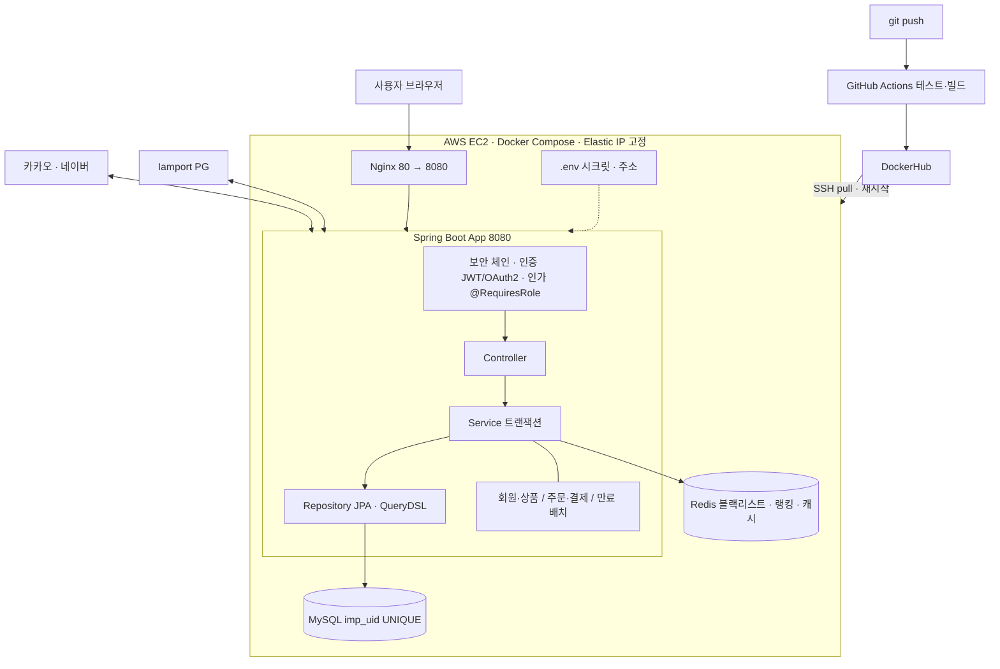
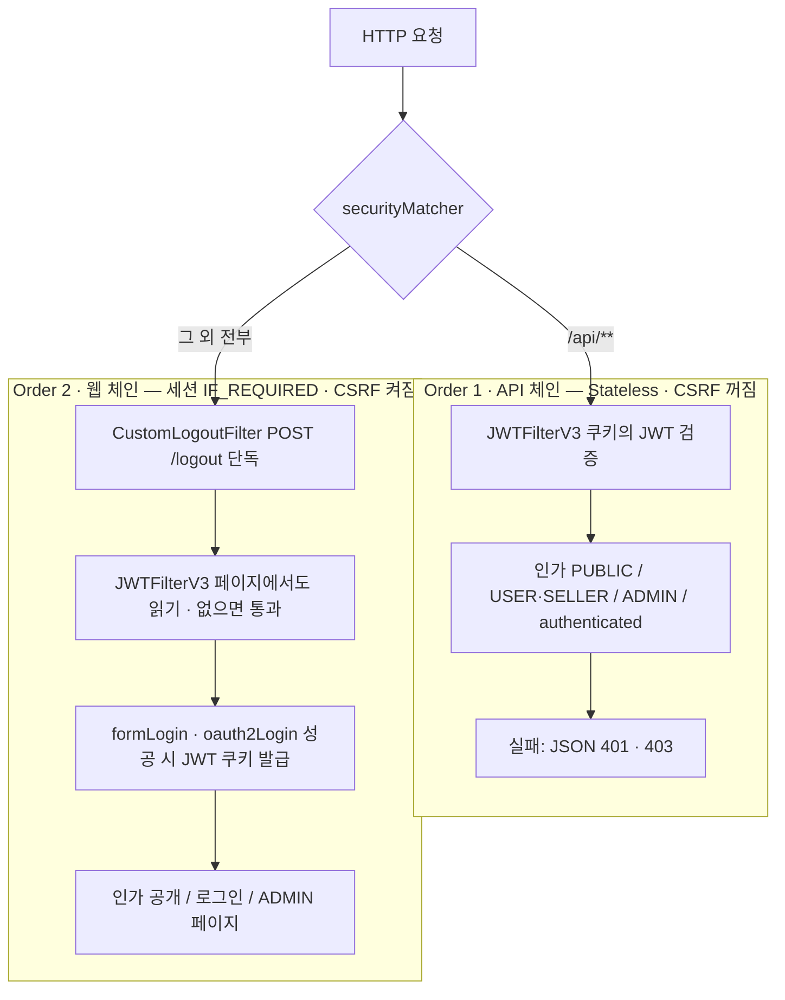
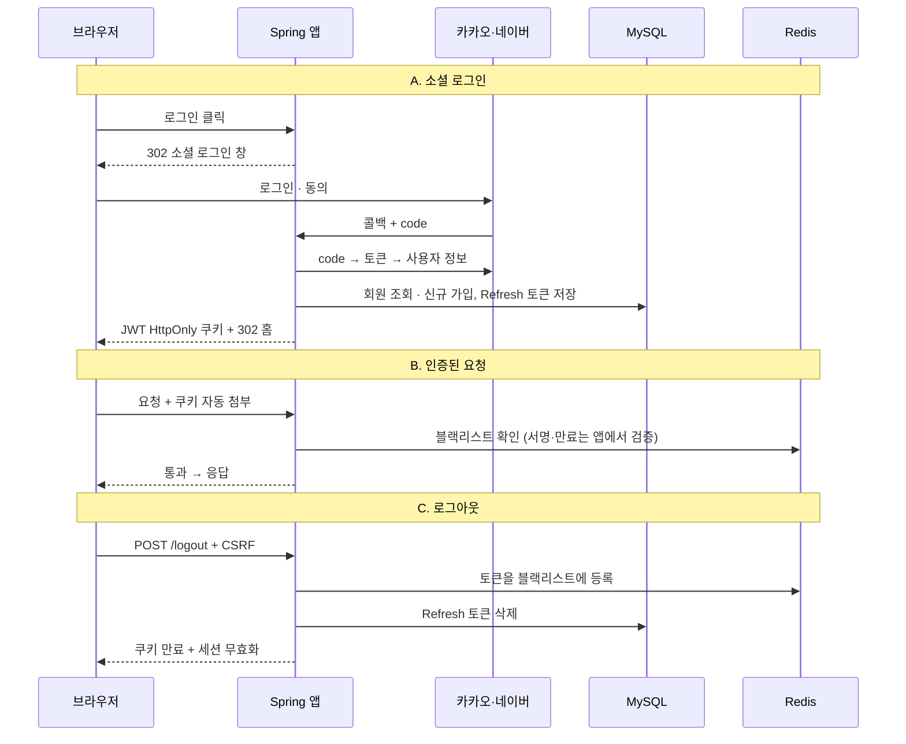
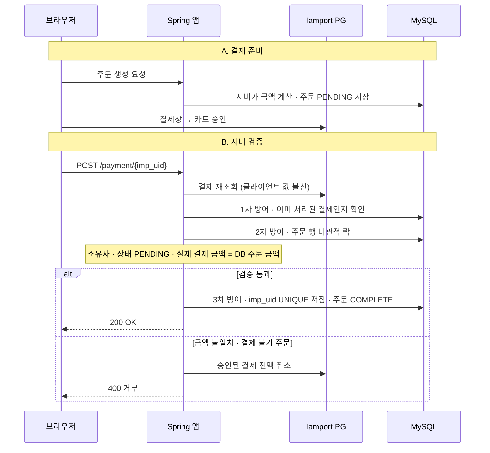

# JooShop — Spring Boot E-Commerce Platform

> 간결하고 읽기 쉬운 구조를 지향한 Spring Boot 쇼핑몰 백엔드입니다. 설계·구현·배포·장애 대응까지 혼자 끝까지 진행했습니다.

**🔗 라이브 데모**: AWS EC2에 Docker Compose + GitHub Actions CI/CD로 실제 배포했습니다. 비용 절감을 위해 필요할 때만 가동하고 있어, 접속 주소는 요청 시 안내드립니다.
**API 문서**: [Postman](https://documenter.getpostman.com/view/16649127/2sB2cUC3Qn) / Swagger(`/swagger-ui/index.html`, 서버 실행 후 접속)
> 도메인/HTTPS는 포트폴리오 목적상 의도적으로 생략했습니다 (서버 주소는 Elastic IP로 고정했고, 비용 절감을 위해 서버를 켜 두는 시간이 제한적이라 접속이 안 되면 알려주세요).

> 이 README는 "코드를 처음 보는 사람이 구조를 빠르게 파악하기 위한" 요약입니다.
> 설계 배경(왜 이렇게 만들었는지), 리팩토링 Before/After, 트러블슈팅 서사는 **[`arrangeFile/portfolio/PROJECT_OVERVIEW.md`](arrangeFile/portfolio/PROJECT_OVERVIEW.md)** 에 자세히 정리되어 있습니다.

---

## 핵심 5가지

| | 한 일 | 근거 |
|---|---|---|
| **1. 인증·보안** | JWT를 HttpOnly 쿠키로 발급하고, 로그아웃한 토큰은 Redis 블랙리스트로 즉시 무효화. 카카오·네이버 OAuth2 연동. API/웹 보안 체인 분리 | [JWT.md](arrangeFile/project_flow/JWT.md) |
| **2. JPA 영속성** | `save()`와 flush 시점, Dirty Checking, 양방향 연관관계 불일치를 원인까지 추적해 해결. 상품 목록 N+1은 `@EntityGraph`로 쿼리 11번 → 1번 | [TROUBLESHOOTING](arrangeFile/concepts/TROUBLESHOOTING.md) #1~#3, #6 |
| **3. 구조 단순화** | Redis 2단계 주문을 Cart→DB 직접 저장으로, JSON 로그인을 Form Login으로 단일화. 핵심 도메인 엔티티(Member/Orders/Product)는 Setter 없이 도메인 메서드로만 상태 변경. 순환 참조는 계층 정리로 해결 | [PROJECT_OVERVIEW](arrangeFile/portfolio/PROJECT_OVERVIEW.md) |
| **4. 주문·결제** | 주문번호·금액(할인가+배송비)을 서버가 확정하고, 결제 후 PG 결제를 **DB 금액 기준으로 재검증**(소유자·주문번호·상태·금액), 불일치 시 승인된 결제를 자동 취소. 중복 결제는 조회 + 주문 행 잠금 + `imp_uid` UNIQUE로 방어(동시 요청 5개 비교 테스트: 조회만 5건 vs 3겹 1건). 주문 상태 전이 규칙, 미결제 주문 만료 배치(재고 복구), 서버 금액 미리보기 API, 주문내역에서 주문 취소(PG 환불 + 재고 복구). 재고 차감은 조건부 UPDATE로 처리하고 동시성 비교 테스트(50 스레드, 재고 10)에서 조회 후 차감 50건 판매 vs 조건부 UPDATE 10건 성공으로 확인 | [PAYMENT_DESIGN](arrangeFile/concepts/PAYMENT_DESIGN.md), [CART_ORDER_PAYMENT](arrangeFile/project_flow/CART_ORDER_PAYMENT.md), TROUBLESHOOTING #9, #11, #12 |
| **5. 배포·운영** | GitHub Actions → DockerHub → EC2 자동 배포, 테스트가 실패하면 배포 차단. 배포 디스크 100%, 노출된 SSH 키·시크릿 교체, Elastic IP로 주소 고정 같은 운영 문제를 직접 겪고 해결 | TROUBLESHOOTING #8, #14 |

한계: HTTPS·도메인 미적용, 모니터링 없음, 이미지는 서버 로컬 저장 → RDS/S3 분리와 Actuator 모니터링이 다음 단계입니다. 결제는 PG 승인 이후 구간(결제 완료·취소)을 자동 테스트로 검증했고 실제 테스트 결제 확인은 남아 있으며, 웹훅·PG 결제 상태 확인은 설계만 해 두었습니다(PAYMENT_DESIGN 7장).

---

## 기술 스택

| 분류 | 기술 |
|------|------|
| **Language** | Java 17 |
| **Framework** | Spring Boot 3, Spring Security 6, Spring Data JPA |
| **Database** | MySQL 8, Redis |
| **Auth** | JWT (Access/Refresh Cookie), OAuth2 (Kakao, Naver), Form Login |
| **Payment** | Iamport (포트원) REST Client |
| **View** | Thymeleaf (Server-side rendering) |
| **Query** | QueryDSL (동적 상품 검색/정렬) |
| **Test** | JUnit5, Mockito, H2, Jacoco (결제 동시성·중복 결제·상태 전이·화면↔API 계약 테스트) |
| **Infra** | Docker, EC2, GitHub Actions CI/CD, Redis(블랙리스트/랭킹/캐싱) |

---

## 아키텍처

핵심 구조 4장입니다. 더 자세한 그림(Nginx·Docker 관계, 주문 상태·재고, 설정 짝 맵)과 설계 이유는 [ARCHITECTURE_INTERVIEW](arrangeFile/portfolio/ARCHITECTURE_INTERVIEW.md)에 있습니다.

### 전체 구성



외부에 열린 문은 Nginx의 80번 하나이고 앱·MySQL·Redis는 Docker 내부망에만 둡니다. 시크릿과 주소는 `.env`로 분리했고, 테스트를 통과한 이미지만 DockerHub를 거쳐 EC2로 배포됩니다.

### 보안 필터 체인



`/api/**`는 Stateless JWT와 JSON 401/403, 그 외 웹 요청은 세션·CSRF·리다이렉트로 처리합니다. 한 체인에 섞으면 세션 정책과 실패 응답 형식이 충돌해서 경로 기준으로 분리했습니다.

### 인증 흐름



JWT는 HttpOnly 쿠키로 내려 XSS로 읽지 못하게 했고, 로그아웃한 토큰은 Redis 블랙리스트에 남은 만료 시간만큼 등록합니다. Refresh 토큰은 DB에 두어 서버가 직접 폐기할 수 있습니다.

### 결제 검증



금액의 기준은 화면이 아니라 서버가 계산해 저장한 DB 금액입니다. PG에서 결제를 다시 조회해 대조하고, 중복 결제는 조회 → 주문 행 잠금 → `imp_uid` UNIQUE 3겹으로 막으며, 금액이 다르면 승인된 결제를 자동 취소합니다.

---

## 모듈 구조

```
JOO.jooshop
│
├── global/
│   ├── authentication/         # 인증 핵심 인프라
│   │   ├── jwts/               # JWT 필터, 핸들러, 유틸, 서비스
│   │   └── oauth2/             # OAuth2 소셜 로그인 처리
│   ├── authorization/          # 역할 기반 인가 (@RequiresRole AOP)
│   ├── config/                 # Spring 설정 (Security, Redis, Iamport 등)
│   ├── exception/               # GlobalExceptionHandler
│   ├── mail/                    # 이메일 인증 서비스
│   ├── image/                   # 이미지 처리 유틸
│   └── demo/                   # 로컬/운영 공통 데모 데이터 초기화
│
├── members/                    # 회원 도메인 (Aggregate Root: Member)
├── order/                      # 주문 도메인 (Aggregate Root: Orders)
├── product/                    # 상품 도메인 (Aggregate Root: Product)
├── productVariant/             # 상품 옵션(사이즈/성별/색상 조합)
├── payment/                    # 결제 도메인 (Iamport 연동)
├── cart/                       # 장바구니
├── address/                    # 배송 주소
├── profile/                    # 프로필 (이미지, 나이, 성별)
├── Inquiry/                    # 상품 문의 / 답변
├── wishList/                   # 위시리스트
├── categorys/                  # 상품 카테고리
├── thumbnail/                  # 상품 대표 이미지
├── productDetailImages/        # 상품 상세 이미지
└── admin/                      # 관리자 (회원, 상품, 주문 관리)
```

---

## 핵심 설계 원칙 (요약)

- **레이어드 아키텍처, 단방향 의존**: `Controller → Service → Repository`. Service가 타 도메인 정보가 필요할 때도 Repository 직접 참조 대신 해당 도메인 Service를 통해서만 접근.
- **DDD Aggregate Root**: `Member`/`Orders`/`Product`는 Setter 없이 도메인 메서드(`member.ban()`, `order.complete()`)로만 상태 변경. 생성은 정적 팩토리 메서드로만 허용.
- **SecurityFilterChain 이중 분리**: `/api/**`(STATELESS, JWT, JSON 응답)와 `/**`(Form/OAuth2, 세션, 리다이렉트)를 별도 체인으로 분리 — REST 클라이언트와 브라우저의 요구사항이 다르기 때문.
- **DTO 규칙**: 응답 DTO는 `@Getter` + `private final`, 변환은 `static from(Entity)`. `@Data` 사용 안 함(불필요한 Setter 노출 방지).

*(각 원칙을 도입한 이유와 Before/After는 PROJECT_OVERVIEW.md 참고)*

---

## 주요 기능 (요약)

| 도메인 | 핵심 구현 |
|---|---|
| 인증 | JWT(HttpOnly Cookie) + OAuth2(Kakao/Naver) + Redis 블랙리스트 로그아웃 |
| 주문/결제 | 장바구니·바로 구매 → 같은 주문 로직(`PENDING` 저장), 서버가 확정한 금액으로 결제, Iamport 재조회 + DB 금액 검증으로 위변조 차단, 만료 배치 |
| 상품 | QueryDSL 동적 필터링(할인/추천/카테고리/정렬), Redis ZSet 실시간 조회수 랭킹 |
| 인가 | `@RequiresRole` 커스텀 AOP — Controller가 아닌 Service 메서드 단위 검증 |
| 예외 처리 | `GlobalExceptionHandler`(`@RestControllerAdvice`)로 컨트롤러 try-catch 일원화 |

*(각 기능의 구현 상세/코드/선택 이유는 PROJECT_OVERVIEW.md의 "주요 기능 구현" 섹션 참고)*

---

## 실행 방법

**Docker로 실행 (가장 간단)**

```bash
cp .env.example .env        # 값 채우기 (JWT_SECRET, DB 비밀번호, 포트원 키 등)
docker compose up --build
# http://localhost  (nginx 경유) / http://localhost:8080 (앱 직접)
```

**환경 변수 설정 (Gradle로 직접 실행할 때)**

```bash
JWT_SECRET=충분히_긴_랜덤_문자열
IMP_API_KEY=포트원_API_키
IMP_SECRET_KEY=포트원_시크릿_키
# OAuth2(KAKAO_SECRET, NAVER_CLIENT_SECRET 등)와 메일(MAIL_PASSWORD)은 `.env.example` 참고
```

**로컬 실행 준비**

1. MySQL — `shop` 데이터베이스 생성
2. Redis — `localhost:6379` 실행
3. `application.yml` — `app.secure: false` 확인
4. Spring Profile `local`(또는 운영)로 실행 시 데모 상품 10건이 최초 1회 자동 생성됨 (이미 있으면 건드리지 않음 — 운영 주문 데이터 보존을 위해 멱등하게 설계)

```bash
./gradlew bootRun --args='--spring.profiles.active=local'
# 기본 포트: http://localhost:8080
```

---

## 핵심 클래스 역할

| 클래스 | 패키지 | 역할 |
|--------|--------|------|
| `JWTUtil` | `jwts/utils` | JWT 생성, 파싱, 검증 — 순수 유틸 |
| `TokenService` | `jwts/service` | 로그인 토큰 발급, 재발급 비즈니스 로직 |
| `TokenCookieWriter` | `jwts/utils` | Access/Refresh를 HttpOnly 쿠키로 write/clear, 환경별 분기 |
| `TokenResolver` | `jwts/utils` | 쿠키·헤더에서 토큰 문자열 추출 |
| `JWTFilterV3` | `jwts/filter` | 매 요청 JWT 검증 → SecurityContext 세팅 |
| `CustomLogoutFilter` | `jwts/filter` | 로그아웃: Redis 블랙리스트 + RefreshToken 삭제 + 쿠키 초기화 + 세션 무효화 |
| `CustomUserDetails` | `jwts/entity` | Spring Security Principal (memberId, role 보관) |
| `FormLoginSuccessHandler` | `jwts/handler` | 폼 로그인 성공 → 토큰 발급 + 리다이렉트 |
| `OAuth2LoginSuccessHandler` | `oauth2/handler` | OAuth2 성공 → 토큰 발급 + 리다이렉트 |
| `CustomOAuth2UserService` | `oauth2/service` | provider 사용자 정보 조회 + 회원 가입/갱신 |
| `MemberAccountService` | `members/service` | 회원 가입/조회/상태 변경 단일 진입점 |
| `ProductQueryHelper` | `global/queries` | QueryDSL BooleanBuilder 조건 조립 |
| `SecurityConfig` | `config/security` | FilterChain 2개 정의 (API JWT / Web Form+OAuth2) |
| `DemoProductInitializer` | `global/demo` | 데모 상품 최초 1회 초기화 (로컬/운영 공통, 있으면 스킵) |

---

## 더 읽어보기

| 문서 | 내용 |
|---|---|
| [`arrangeFile/portfolio/PROJECT_OVERVIEW.md`](arrangeFile/portfolio/PROJECT_OVERVIEW.md) | 설계 배경, 주요 기능 구현 상세, 트러블슈팅, 리팩토링 Before/After, Self-review |
| [`arrangeFile/portfolio/ERD.md`](arrangeFile/portfolio/ERD.md) | 전체 테이블 구조 및 관계 다이어그램 |
| [`arrangeFile/portfolio/INTERVIEW_REFACTORING_STORY.md`](arrangeFile/portfolio/INTERVIEW_REFACTORING_STORY.md) | 면접 대비 — 리팩토링 서사, 예상 질문/답변 |
| [`arrangeFile/project_flow/`](arrangeFile/project_flow) | 로그인/JWT/OAuth2/주문·결제 흐름 등 코드 단위 상세 정리 |
| [`arrangeFile/concepts/PAYMENT_DESIGN.md`](arrangeFile/concepts/PAYMENT_DESIGN.md) | 결제 설계 — 겪은 문제 24건, 보완 코드, 구현 체크리스트, 실제 환경 검증 기록, 구조 변경, 앞으로의 계획 |
| [`arrangeFile/concepts/TROUBLESHOOTING.md`](arrangeFile/concepts/TROUBLESHOOTING.md) | 장애 기록 14건 (문제/원인/해결/러닝포인트) |
